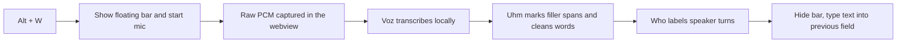

# WisprType

A local-first, open alternative to Wispr Flow. Press **Alt + W** anywhere on Windows, speak, and the cleaned transcript is typed straight into the field you were using. Audio never leaves your machine.

The app is a Tauri 2 desktop shell around a TanStack Start UI. Speech recognition, filler cleanup and speaker labeling run on-device with small specialized models from [Desert Ant Labs](https://desertant.com/): [Voz](https://desertant.com/models/voz/) for transcription, [Uhm](https://desertant.com/models/uhm/) for removing "um", "uh" and "hmm" spans, and [Who](https://desertant.com/models/who/) for labeling who said what.

## Features

- **Global Alt + W** floating bar that appears over any application
- **On-device transcription** with word-level timestamps (Voz)
- **Filler removal** matched to the transcript's word timings (Uhm)
- **Speaker labeling** for multi-speaker audio, with `Speaker 1:` lines (Who)
- **Types into the focused field** using keyboard simulation, so it works in any Windows text field
- **Recording and Live modes** from the pill dropdown: one cleans a finished note, the other types as you speak
- **Sound-reactive waveform** driven by the microphone spectrum, with a blinking listening dot and thicker pink outline
- **No cloud inference, no per-minute bill** after the one-time model download
- Smooth pill animation, spinner and model download progress
- Monorepo layout: web UI in `apps/web`, shared packages, native shell in `src-tauri`

## How it works



The global shortcut is registered in Rust and forwarded to the webview as an event. The webview owns the recording state machine, so the UI can finish transcribing before the window closes.

## Stack

| Layer | Choice |
| --- | --- |
| Desktop shell | Tauri 2.12, Rust 1.90+ |
| Frontend | TanStack Start, React 19, TypeScript |
| Build tool | Vite 8 |
| Monorepo | Turborepo with npm workspaces |
| Speech recognition | `@desert-ant-labs/voz` (WASM + ONNX Runtime Web) |
| Filler detection | `@desert-ant-labs/uhm` (LiteRT.js) |
| Keyboard insertion | `enigo` (Rust) |

## Prerequisites

- Node.js 24+ and npm 11+
- Rust 1.90+ via [rustup](https://rustup.rs/) with the MSVC toolchain
- Windows 11 (first target) with WebView2 and a working WebGPU adapter
- A microphone, and permission to use it

## Run locally

```bash
npm install
npm run tauri:dev
```

`tauri dev` starts the TanStack Start dev server on port 3000 and opens the desktop window. Click the orb or press **Alt + W** to start dictation; press **Alt + W** again to finish.

For UI-only work in a browser:

```bash
npm run dev --workspace=web
```

In the browser the result is copied to the clipboard instead of typed into a field.

## Build the Windows app

```bash
npm run tauri:build
```

Installers are written to `src-tauri/target/release/bundle` (MSI and NSIS).

## Models and privacy

| Model | Job | Browser download | Notes |
| --- | --- | --- | --- |
| Voz | Transcript + word timestamps | about 409 MB | 25 languages; needs WebGPU; roughly 1.2 GB resident memory while loaded |
| Uhm | Filler spans aligned to words | about 51 MB | Trained on English; transfers acoustically to Spanish, French, German and Dutch |
| Who | Speaker turns with timestamps | about 32 MB (8-bit) | CPU/LiteRT in the browser; up to 4 speakers per 5-minute section; pair with Voz for labeled transcripts |

All three models download from Hugging Face and load into memory when the app launches, then stay cached and resident for later dictations. No account or token is required for the download. Set `HF_TOKEN` only if you hit Hugging Face rate limits. Audio, text and model files stay on the device; there is no inference server.

For a production release, Desert Ant requires a free API key from [platform.desertant.com](https://platform.desertant.com), configured with `DesertAnt.configure({ apiKey })` before the first model load. Development works without one. Their SDK and weights use the [Desert Ant Labs Source-Available License](https://license.desertant.com/), not MIT; review it before distributing a commercial build.

## Known limits

- First launch downloads and warms all three models; dictation after that starts immediately.
- Voz needs a WebGPU-capable WebView2. Without a usable GPU it falls back to CPU and is much slower.
- Voz does not detect language. Unsupported languages can produce confident but wrong text.
- Uhm is English-first; filler cleanup is less reliable with music, laughter or overlapping speakers.
- Who is beta, runs on CPU in the browser, and works best with close-miked voices; speaker labels are numbers, not names.
- Typing targets the field that had focus before the bar opened. It uses clipboard-free keyboard simulation through `enigo`, so very long transcripts type more slowly than a paste would.
- The attached `image.png` pill reference in the build request could not be inspected by the agent; the pill design here follows the written description.

## Project structure

```text
wispr-type/
├── apps/web/
│   └── src/
│       ├── lib/audio.ts       # microphone to raw PCM
│       ├── lib/desktop.ts     # Tauri commands and events
│       ├── lib/engine.ts      # Voz + Uhm pipeline
│       └── routes/index.tsx   # floating pill UI
├── packages/
│   ├── eslint-config/
│   └── typescript-config/
├── src-tauri/
│   ├── capabilities/          # plugin permissions
│   ├── src/lib.rs             # global shortcut and typing commands
│   └── tauri.conf.json        # transparent, always-on-top bar window
└── turbo.json
```

## Roadmap

- Language detection before transcription
- Custom vocabulary for names and technical terms
- Tray icon and settings window
- macOS and Linux targets

## License

Desktop shell and web UI are yours to use under the repository license. The Desert Ant models and SDKs carry their own Source-Available License; see the Models section above.
